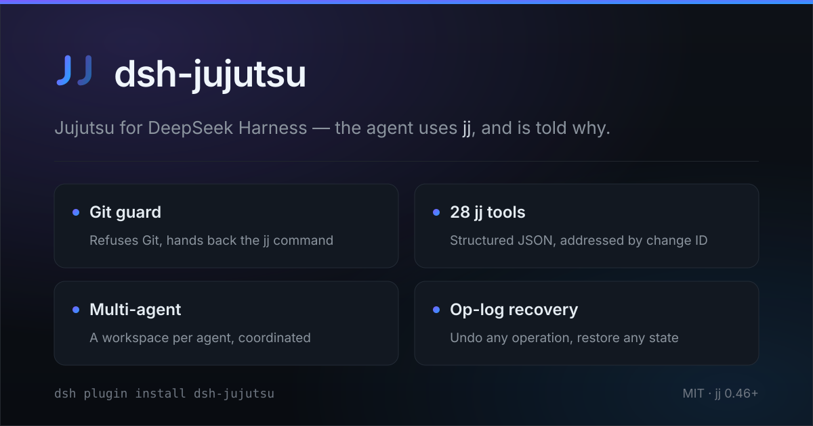

<p align="center">
  
</p>

<h1 align="center">dsh-jujutsu</h1>

<p align="center"><b>Jujutsu for DeepSeek Harness.</b> Inside a <a href="https://jj-vcs.dev">Jujutsu</a> workspace the agent stops reaching for Git and uses <code>jj</code> instead — and it is told why, rather than just being blocked.</p>

<p align="center">
  <a href="https://www.npmjs.com/package/dsh-jujutsu"></a>
  <a href="https://github.com/viztor/dsh-jujutsu/actions/workflows/ci.yml"></a>
  <a href="LICENSE"></a>
</p>



## Install

```bash
dsh plugin install dsh-jujutsu
```

Or install from the harness **Plugins** page, then open **Plugins → Jujutsu** to configure it. It works out of the box; the defaults are safe.

|           |                                                                                                                                                                                                 |
| --------- | ----------------------------------------------------------------------------------------------------------------------------------------------------------------------------------------------- |
| `jj`      | **Required.** 0.46.0 or newer. `brew install jj`                                                                                                                                                |
| `jj-hunk` | Optional. Adds hunk-level `split`/`squash`; without it those two tools report unavailable rather than failing. `cargo install --git https://github.com/laulauland/jj-hunk --tag v0.5.1 jj-hunk` |
| Node      | 24 or newer                                                                                                                                                                                     |

## What it does

### Refuses Git, and hands back the `jj` command

The refusal is **translated, not templated**: the guard parses the command you typed and returns the exact `jj` command it maps to.

| You run                | What happens                                                                      |
| ---------------------- | --------------------------------------------------------------------------------- |
| `git status`           | `Refused: git status. Run: jj status`                                             |
| `git log --oneline -6` | `Refused: git log --oneline -6. Run: jj log -r ::@ --limit 6 --no-graph`          |
| `git diff HEAD~1`      | `Refused: git diff HEAD~1. Run: jj diff --from @-`                                |
| `git push origin main` | `Refused: git push origin main. Run: jj git push --remote origin --bookmark main` |
| `git add src/a.ts`     | Refused with the reason instead of a command: there is no staging area to add to  |
| `git rebase -i`        | Refused — it needs a terminal. Suggests `jj rebase`, `jj squash`, `jj absorb`     |
| `rm -rf .git`          | Refused, and explains that `jj`'s commit objects live there                       |
| `echo "git commit"`    | Runs — it never touched Git                                                       |

Git revisions are rewritten into revsets (`HEAD~2` → `@--`, because `HEAD` is not a `jj` revset), anything that does not map exactly falls back to the catalogue wording rather than a half-translated command, and every argument is shell-quoted. Reads and writes are configured separately — letting the model _look_ with Git is not the same as letting it _write_.

### The `jj` tools

28 tools by default, with `core` (14) and `minimal` (5) for smaller prompts. Every one returns structured JSON, and revisions are addressed by **change ID**, which survives a rewrite.

| Group               | Tools                                                                            |
| ------------------- | -------------------------------------------------------------------------------- |
| Read                | `jj_status`, `jj_log`, `jj_diff`, `jj_show`, `jj_file`, `jj_evolog`, `jj_op_log` |
| Author              | `jj_new`, `jj_commit`, `jj_describe`, `jj_edit`, `jj_squash`, `jj_bookmark`      |
| Hunks               | `jj_hunk_list`, `jj_hunk_apply`                                                  |
| History / recovery  | `jj_history`, `jj_op`, `jj_op_restore`, `jj_repair`                              |
| Workspaces / verify | `jj_workspace`, `jj_test`                                                        |
| Publish / hygiene   | `jj_publish`, `jj_fix`, `jj_sparse`                                              |
| Coordination        | `jj_coordinate`, `jj_group`, `jj_doctor`, `jj_sign`                              |

Reads pass `--ignore-working-copy`, so a history read never snapshots another agent's half-written files. `jj_status({snapshot:true})` is the explicit checkpoint and the only read that writes.

### Teaches the model

The system prompt says version control here is Jujutsu, and what that implies: no staging area, `@` is always a commit, change IDs survive rewrites. The rule is withheld where it would be false — in a plain Git repo, or in a directory with no repository at all. With no version control the plugin says so, so the agent can offer `jj git init` (colocated, so Git tooling still works).

Plain Git repositories can be adopted deliberately. Turn on _Use Jujutsu in Git repos_ and the first session in a Git repo with no `.jj` runs `jj git init --colocate`: the history is imported, `.git` is untouched. It is refused outright for repositories `jj` cannot represent — LFS, sparse checkouts, shallow clones, linked worktrees, and a Git operation in progress. Submodules are fine. See [docs/37](docs/37-git-compatible-adoption.md).

The manual — the working-copy model, the Git→`jj` verb map, what each tool returns, and the six workflow rules a real session had to learn the hard way — ships as a `jujutsu` runtime skill, so its cost is one catalog line until the model needs it. Turn it off with _Offer the jj manual_. The failure behind each rule, with the exact commands that produced it, is [docs/41](docs/41-jj-workflow-patterns.md).

## Configuration

Open **Plugins → Jujutsu**. Most settings are on that page:

| Setting                         | Default | What it changes                                                                    |
| ------------------------------- | ------- | ---------------------------------------------------------------------------------- |
| Guard                           | on      | Off leaves the guard mounted but inert — useful to see what it _would_ have caught |
| Read-only Git                   | `ask`   | What to do with `git status`, `git log`, …                                         |
| Writing Git                     | `ask`   | What to do with `git commit`, `git push`, …                                        |
| Remember approvals              | on      | Stop re-asking about a verb you already approved, for this session                 |
| Mention missing version control | on      | Tell the model when a directory has no repository                                  |
| Prefer Jujutsu                  | on      | Suggest `jj git init` rather than `git init`                                       |
| Explain Jujutsu in the prompt   | on      | Off means the guard still refuses Git but the model is not told why                |
| Offer the jj manual             | on      | Ship the `jj` manual as an on-demand skill                                         |
| Use Jujutsu in Git repos        | off     | Adopt a plain Git repo by creating `.jj` beside `.git`                             |
| Force Jujutsu                   | off     | Refuse `jj` outside a workspace, naming `jj git init --colocate`                   |
| Tool surface                    | full    | `full`, `core` (14 tools), or `minimal` (5 tools)                                  |
| Publishing                      | ask     | `jj_publish` push: `ask` (dry-run preview), `deny`, or `allow`                     |
| Workspace ownership             | advise  | `off`, `advise`, or `enforce` when a tool targets another workspace's `@`          |
| Default grouping                | merge   | What `jj_coordinate` suggests: `merge` or `stack`                                  |

### Advanced: not on the page

These are config-file only, because only an unusual install needs them. They are ordinary `Config` fields:

| Setting               | Default            | What it changes                                                         |
| --------------------- | ------------------ | ----------------------------------------------------------------------- |
| `jjPath`              | `jj`               | Set when `jj` is not on `PATH`, or to pin a specific build              |
| `jjHunkPath`          | `jj-hunk`          | Same, for `jj-hunk`                                                     |
| `hunkInstall`         | `ask`              | What to do when `jj-hunk` is missing: `ask`, `never`, or `auto`         |
| `verifyCloneDirs`     | `["node_modules"]` | Directories `jj_test` copy-on-write clones into its ephemeral workspace |
| `agentBookmarkPrefix` | `agent/`           | Bookmark prefix recording workspace ownership; empty disables           |
| `workspaceRoot`       | `..`               | Directory `jj_workspace add` uses when no path is passed                |

### Turning it off for one project

Drop a `.dsh-jujutsu.json` in the project root:

```json
{ "enabled": false }
```

The **nearest** marker walking up from the working directory wins, so you can disable a monorepo and re-enable one vendored `jj` repo inside it with `{"enabled": true}`. The same file takes the two opt-ins per project — `{"adopt": true}` / `{"adopt": false}` and `{"forceJj": true}` / `{"forceJj": false}` — and `{"enabled": false}` vetoes both. A malformed marker is ignored rather than obeyed, so a typo cannot silently disable the guard.

## Troubleshooting

**"Refused" when I wanted Git.** That is the plugin working. Set _Read-only Git_ or _Writing Git_ to `allow`, or add `.dsh-jujutsu.json` with `{"enabled": false}` for that project.

**Nothing happens at all.** The plugin only acts inside a Jujutsu workspace — a directory with a `.jj` directory, in it or any parent. Check with `jj status`; if that says _"There is no jj repo in '.'"_, the plugin is correctly inactive. `jj git init` creates one (colocated by default). To take over a directory anyway, turn on _Force Jujutsu_: `jj` commands are then refused with the initialisation command.

**The hunk tools say unavailable.** `jj-hunk` is not installed or not on `PATH`. Set _jj-hunk executable_ to an absolute path, or install it:

```bash
cargo install --git https://github.com/laulauland/jj-hunk --tag v0.5.1 jj-hunk
```

Do not run `cargo install jj-hunk`: the published crate is the same project two minor versions behind, with a different CLI that rejects the query interface these tools use (`unexpected argument '--query' found`). The pinned git install above is what the plugin is tested against.

**`jj new` or `jj commit` is refused.** The plugin refuses commit-creating commands when `jj` has no identity configured, because `jj` would create a commit with an empty author that cannot be pushed:

```bash
jj config set --user user.name "Your Name"
jj config set --user user.email "you@example.com"
```

Commands that preserve an author — `jj describe`, `jj squash` — are not affected.

## For developers

```bash
pnpm run build           # tsc -> lib/   then   vp pack -> lib/client.js
pnpm run ci              # vp check, build, suite, package checks — the whole gate
pnpm run package-check   # just the tarball and release-wiring checks
```

`lib/` is emitted JavaScript and is not committed: Node refuses to strip types under `node_modules`, so the published entry is built. There are two artifacts — `lib/index.js` (the host half, `tsc`) and `lib/client.js` (the browser half, `vp pack`, wrapped for the web client's module loader).

Releases go through CI with npm's OIDC trusted publishing, so there is no token to hold and provenance is automatic. See [CONTRIBUTING.md](CONTRIBUTING.md#releasing).

|               |                                                                                        |
| ------------- | -------------------------------------------------------------------------------------- |
| `src/`        | The host half — guard, tools, prompt, detection. See [`src/README.md`](src/README.md). |
| `src/client/` | The panel, built to `lib/client.js` by `vp pack`.                                      |
| `locale/`     | Display name and one-liner, per language.                                              |
| `SPEC.md`     | The build specification.                                                               |
| `docs/`       | The design record: verified contracts, measurements, decisions.                        |

The harness contract and the `jj` behaviour are both verified against the real thing, with citations in [docs/11](docs/11-verified-dsh-api-contract.md) and [docs/13](docs/13-empirical-verification.md). **410 tests**, `pnpm run ci` green.

## License

MIT — see [LICENSE](LICENSE).
